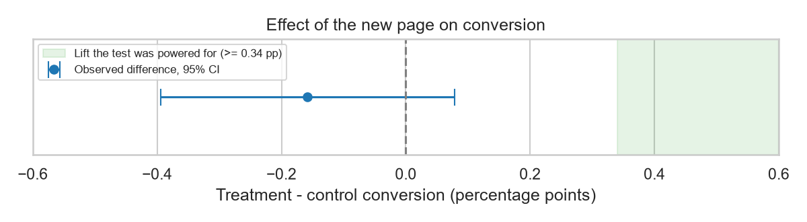
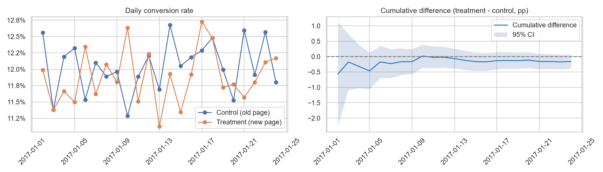
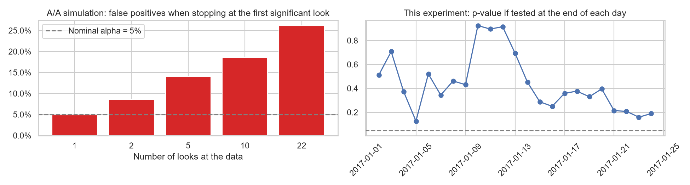

# Landing Page A/B Test: Should We Ship the New Page?

> An end-to-end analysis of a real e-commerce landing page experiment (290K users, 22 days): data quality audit, experiment validity checks, power analysis, significance testing, robustness checks and a clear ship / no-ship recommendation.



## Result

**Recommendation: do not ship the new page.**

| | Control (old page) | Treatment (new page) |
|---|---|---|
| Users | 145,274 | 145,310 |
| Conversion rate | 12.04% | 11.88% |

- **Effect**: -0.16 percentage points (-1.3% relative), 95% CI [-0.39, +0.08] pp, p = 0.19.
- **Not just "not significant"**: the test could detect a change of 0.34 pp with 80% power, and the confidence interval rules out any lift above +0.08 pp (+0.6% relative). Even in the best case the new page is essentially no better.
- **Bayesian view**: ~10% probability that the new page is better; the expected loss from shipping it is about 30x the expected loss from keeping the old page.
- **Why not keep testing**: confirming a lift as small as the best case would need millions of users per group, and a lift that small would rarely pay for a redesign.

## What the analysis covers

| Step | Question | Finding |
|---|---|---|
| Data quality | Did users see the page they were assigned to? | 3,893 rows (1.3%) have a group/page mismatch and are the source of all but one duplicate user; removed |
| Sample ratio mismatch | Was the split really 50/50? | Yes: chi-square p = 0.95, stable every day |
| Power | What could the test detect? | MDE = 0.34 pp (2.8% relative) at 80% power |
| Primary test | Is there a difference? | Two-proportion z-test, p = 0.19 |
| Sensitivity | Does the cleaning rule matter? | No: three cleaning rules give -0.18 to -0.16 pp, none significant |
| Novelty effect | Does the effect change over time? | No trend by day or by week |
| Segments | Does it work for some users? | Weekend looks significant on its own (p = 0.037) but not after Holm correction (p = 0.22) |
| Peeking | What if we had checked daily? | A/A simulation: stopping at the first significant daily look inflates false positives from 5% to ~26% |

The full analysis, with charts and reasoning, is in [notebooks/analysis.ipynb](notebooks/analysis.ipynb).





## Statistics module

The methods are implemented from the formulas in [`src/abtest/stats.py`](src/abtest/stats.py) using numpy / scipy, rather than called from a testing library, and are covered by unit tests in [`tests/test_stats.py`](tests/test_stats.py):

| Function | Purpose | Verified against |
|---|---|---|
| `srm_test` | Sample ratio mismatch (chi-square goodness of fit) | Balanced and imbalanced splits |
| `sample_size_per_group`, `power_of_test`, `minimum_detectable_effect` | Experiment sizing | Textbook value (10% baseline, +2 pp → ~3,841 per group) and mutual consistency |
| `two_proportion_ztest` | Significance test and confidence interval | Equivalence with scipy's 2x2 chi-square test |
| `holm_adjust` | Multiple-testing correction | Worked example |
| `bayesian_ab` | Beta-Binomial posterior, P(treatment better), expected loss | Identical groups → 50% |
| `peeking_false_positive_rate` | A/A simulation of repeated looks | One look → ~5% |

## Why this project

My [Olist e-commerce analysis](https://github.com/Shawn-Xiao40/olist-ecommerce-analysis) found that late deliveries are associated with 5.9x more bad reviews. That is a correlation from observational data: it cannot show that lateness *causes* bad reviews. Establishing cause and effect needs a randomized experiment, and this project shows how such an experiment is validated, analysed and turned into a decision.

## Data

[A/B testing dataset](https://www.kaggle.com/datasets/zhangluyuan/ab-testing) on Kaggle: 294,478 rows with `user_id`, `timestamp`, `group`, `landing_page` and `converted`. The data file is not included in this repository; download `ab_data.csv` and place it in `data/raw/`.

Limitations: the dataset has no user attributes, revenue or business context, so the analysis covers conversion only and segments are limited to visit time.

## How to run

```bash
python -m venv .venv
.venv\Scripts\activate          # macOS/Linux: source .venv/bin/activate
pip install -r requirements.txt

pytest                          # run the unit tests
jupyter lab notebooks/analysis.ipynb
```

## Project structure

```
ab-test-analysis/
├── data/raw/              # ab_data.csv (not committed)
├── src/abtest/stats.py    # statistics module
├── tests/test_stats.py    # unit tests
├── notebooks/analysis.ipynb
└── reports/figures/       # charts exported by the notebook
```
